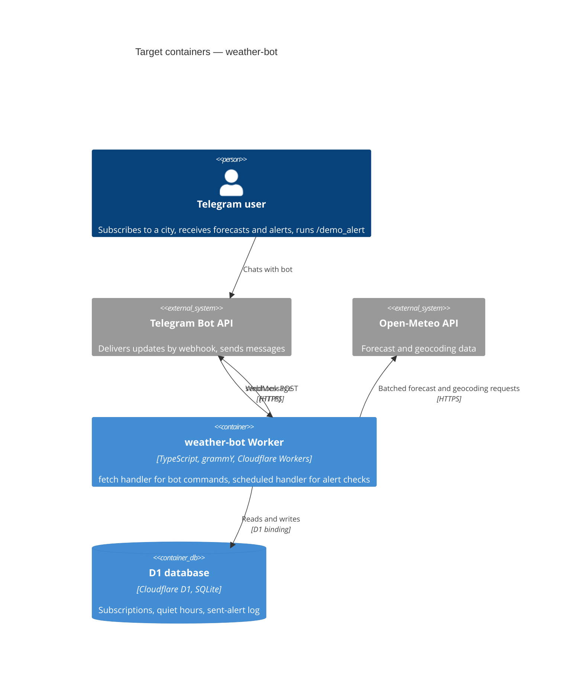

# Architecture map — weather-bot

> The **target foundation** for weather-bot. It was fixed by `survey` in greenfield mode on
> 2026-11-05 and is the baseline that `scaffold` builds and every later feature follows. The repo
> had no source code at `0262bf8`, so the paths below are targets, not existing files. Once the
> skeleton exists, refresh this map with `survey` and it switches to `mode: current`. The product
> intent comes from [`docs/idea-brief.md`](idea-brief.md).

## Stack

- **Language / runtime:** TypeScript in `strict` mode, running on the Cloudflare Workers runtime (workerd). Local tooling uses Node 26 LTS (`.nvmrc`) and npm. See [ADR-0001](adr/0001-run-on-cloudflare-workers-with-webhook-and-cron.md).
- **Frameworks / libraries:**
  - grammY for the Telegram Bot API, using `webhookCallback` with the Cloudflare adapter.
  - Wrangler for local dev, deploys, secrets and D1 migrations.
- **External data:** the Open-Meteo forecast and geocoding APIs. Free, no key, non-commercial use. Accessed only through an adapter.
- **Build / test / lint** (npm scripts that `scaffold` creates):
  - `npm run build`: `wrangler deploy --dry-run --outdir dist`, which bundles and type-checks the Worker.
  - `npm run typecheck`: `tsc --noEmit`.
  - `npm test`: Vitest, unit and integration.
  - `npm run lint`: ESLint (typescript-eslint) plus `prettier --check`.

## C4 — system as it is

This is the target baseline that `scaffold` builds and features fill in.

## Module inventory

There's a single deployable. The internal layers follow [ADR-0002](adr/0002-organize-code-as-ports-and-adapters.md).

| Module | Path | Layers | Wired at | Responsibility |
|---|---|---|---|---|
| domain | `src/domain/` | domain | (pure, imported by app) | Weather snapshots, alert rules (rain soon, sharp temperature change), alert de-duplication keys, quiet-hours and timezone logic. No I/O and no platform imports. |
| app | `src/app/` | app + ports | `src/worker.ts` | Use cases (subscribe to city, get weather now, set quiet hours, run alert check, demo alert) and the port interfaces they need (`WeatherProvider`, `SubscriptionRepo`, `AlertLog`, `Notifier`, `Clock`) |
| adapters | `src/adapters/` | infra | `src/worker.ts` | `telegram/` (grammY bot and command handlers), `open-meteo/`, `d1/` (repos), `clock/` |
| entry | `src/worker.ts` | composition root | Wrangler `main` in `wrangler.toml` | Builds the adapters from `env`. `fetch` goes to grammY `webhookCallback`, `scheduled` to the run-alert-check use case. |
| migrations | `migrations/` | schema | `wrangler.toml` `[[d1_databases]]` | Versioned D1 SQL migrations |

## Conventions (cited — the rules a new feature must match)

These are target conventions; the paths are created by `scaffold`.

- **Module wiring:** constructor injection, done by hand in the composition root `src/worker.ts`, with no DI container. `domain` imports nothing from `app` or `adapters`, and `app` imports only `domain` and its own ports. ESLint import-boundary rules enforce this.
- **Error handling:** expected failures (unknown city, provider unavailable, invalid quiet-hours input) are returned as a typed `Result<T, E>` from `src/domain/result.ts`, never thrown. Adapters turn errors into a short user-facing bot reply plus a structured `console.log(JSON)` line. Unexpected exceptions are caught once at the entry point and logged, and the webhook still returns 200 so Telegram doesn't retry-storm.
- **IDs:** the Telegram `chat_id` is the natural key for a subscriber. A sent alert is identified by a deterministic de-duplication key (chat + alert type + forecast window), not a random ID.
- **Time:** all stored times are UTC ISO-8601. Each user has an IANA timezone, which quiet-hours logic uses through `Intl`. Code reads time only through the `Clock` port, so tests control it.
- **Persistence / DB access:** D1 is accessed only from `src/adapters/d1/` using parameterised prepared statements. The DB is plain storage, with no triggers or business logic in SQL.
- **Migrations:** `wrangler d1 migrations` with files `migrations/NNNN_<snake_name>.sql`. They are forward-only, because Wrangler has no down migrations, so a rollback is written as a new forward migration. See [ADR-0003](adr/0003-store-state-in-cloudflare-d1.md).
- **Tests:** Vitest.
  - Unit tests live next to the code as `*.test.ts`, for domain and app with fake ports.
  - Integration tests live in `test/integration/` and run inside workerd through `@cloudflare/vitest-plugin` (the renamed `vitest-pool-workers`), with a real local D1 and migrations applied.
  - Outbound HTTP (Telegram, Open-Meteo) is stubbed with recorded fixtures in `test/fixtures/`.
- **Inter-module communication:** direct in-process calls through ports, with no events or queues.
- **Secrets / config:** `BOT_TOKEN` and `WEBHOOK_SECRET` are set with `wrangler secret put` in production and in a gitignored `.dev.vars` locally. The webhook checks Telegram's `X-Telegram-Bot-Api-Secret-Token` header. Nothing secret goes in `wrangler.toml`.
- **CI:** one GitHub Actions workflow, `.github/workflows/ci.yml`, runs `npm ci`, then typecheck, lint, test and build on every push and PR.
- **UI / styling:** N/A. There's no frontend, and the UI is Telegram chat.

## Datastores

| Store | Engine | Accessed via | Notes |
|---|---|---|---|
| D1 `weather-bot-db` | Cloudflare D1 (SQLite) | `src/adapters/d1/*` through the `DB` binding | Free plan, reportedly 5M rows read and 100k rows written per day, 5 GB total. Queries fail once a daily limit is hit, so cron reads must be batched. |

## Frontend / UI foundation

<!-- N/A: no frontend -->

N/A: there's no frontend. Users interact through Telegram commands and messages, handled in `src/adapters/telegram/`.

## Where things live / closest precedents

- A new bot command goes in `src/adapters/telegram/commands/<name>.ts`, which calls a use case in `src/app/<use-case>.ts`. Pure rules go in `src/domain/`. The first command built by a feature becomes the precedent; `scaffold` adds only `/start`.
- A new alert rule is a pure function in `src/domain/alerts/<rule>.ts` with table-driven unit tests, registered in the alert-rule list used by the run-alert-check use case.
- A new external data source is a new adapter implementing an existing port. Use cases don't change.
- A new table or column is a new `migrations/NNNN_*.sql` plus a repo change in `src/adapters/d1/`.

## Constraints & known tech-debt

- **Free plan only** (owner-required, idea brief §5). There's no paid tier, so every design must fit the Workers Free, D1 Free and Open-Meteo free limits.
- **CPU per invocation is limited** on Workers Free. Sources conflict (10 ms vs. more), so check the official limits page before design. Network waits don't count. The scheduled alert check must batch Open-Meteo requests (multi-location) and keep per-run computation small. It may need to process subscribers in chunks across cron ticks.
- **Subrequests per invocation are capped** on the free plan (reportedly 50). Batch outbound calls.
- **Webhook only.** Long polling isn't possible on Workers, so local dev uses `wrangler dev` plus a tunnel, or integration tests.
- **Open-Meteo is non-commercial and rate-limited** (reportedly 10k calls a day). Fine for a personal bot. Attribution goes in the README.
- **Cron cadence is 15 min.** "Rain within ~1h" alerts can therefore fire up to 15 min late, which is acceptable for v1.
- **Forward-only migrations.** See Migrations above.

## Reconciliation with the authored architecture doc

There's no authored architecture doc, so this map is the reference foundation. It's consistent with the owner constraints in [`docs/idea-brief.md`](idea-brief.md) §5: TypeScript/Node, free hosting only, Telegram.
