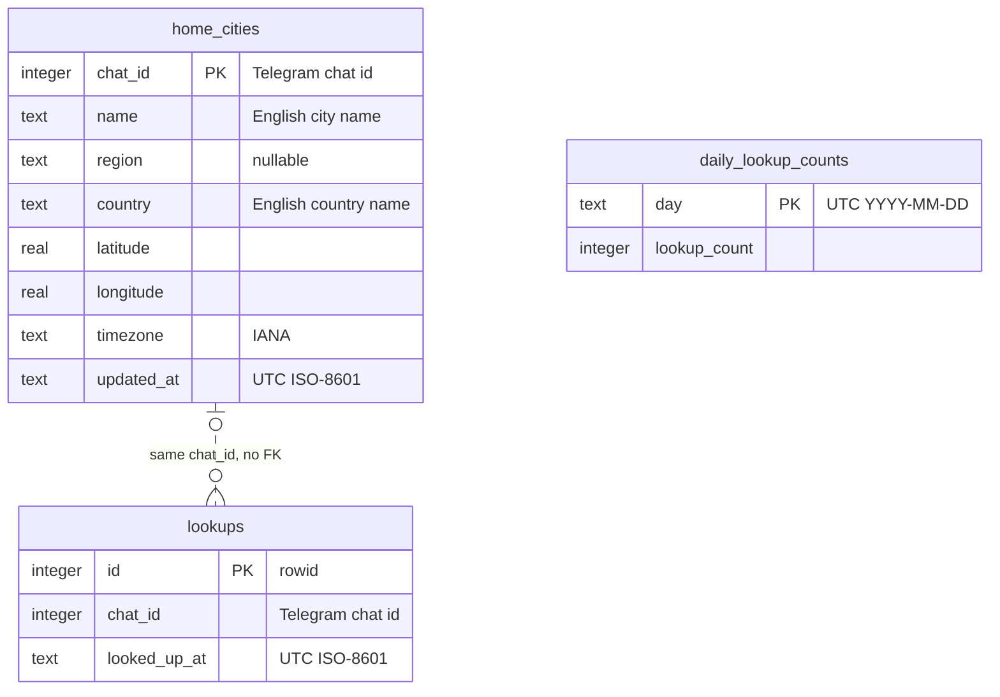

# Data model — base-logic

> **Inputs:** [spec.md](./spec.md) §5, §6.1 · [sad.md](./sad.md) §4, §5, §6 (persist notes), §8 · feature [ADR-0001](adr/0001-count-lookups-in-d1-tables.md) · project [ADR-0003](../../adr/0003-store-state-in-cloudflare-d1.md) · [architecture-map](../../architecture-map.md) §Conventions.

**Conventions followed.** These come from the architecture, and the owner confirmed them on 2026-11-06 for this first set of tables:

- Engine: Cloudflare D1 (SQLite), using `wrangler d1 migrations`.
- Migrations are forward-only (ADR-0003). There are no `.down` files: an undo is a new forward migration (see [Rollback](#rollback)).
- Tables: plural `snake_case`. Columns: `snake_case`.
- Every table is declared `STRICT`, so SQLite enforces the declared column types. There are no `CHECK` constraints, triggers or DB defaults ("plain storage, no logic in SQL"). Validation and every timestamp come from domain code and the `Clock` port.
- Times are stored as UTC ISO-8601 `TEXT` (`Date.prototype.toISOString()`, fixed width, so string order is time order). The day key is UTC `YYYY-MM-DD`.
- The Telegram chat id is the natural key (architecture-map §IDs). Only the append-only lookup log uses a surrogate `rowid`.
- Audit columns: `updated_at` only, on `home_cities`. The other two tables already carry a time or day key.

## ER diagram



## Entities

There are three independent aggregate roots. None references another by foreign key:

- **Home city** (`home_cities`): one per private chat, replaced on every successful set-city (AC-02, AC-14).
- **Chat lookup log** (`lookups`): append-only rows per chat, pruned once older than 60 minutes (AC-16, ADR-0001). It is related to `home_cities` only by sharing `chat_id`. A first-time chat makes its lookup before it has a Home city, and a failed set-city is still counted (AC-16), so a foreign key would be wrong.
- **Daily lookup counter** (`daily_lookup_counts`): one row per UTC day for the whole bot (AC-17, ADR-0001). Step 3 (alerts) reads the same row.

### `home_cities`

| Column | Type | Constraints | Notes |
|---|---|---|---|
| `chat_id` | INTEGER | PK (rowid alias) | The Telegram chat id of the private chat. Telegram ids fit in 52 bits, which is safe as a JS `number` and as SQLite INTEGER. |
| `name` | TEXT | NOT NULL | The geocoder's English place name ("Kyiv"), never the raw query (spec §6.1) |
| `region` | TEXT | NULL | The geocoder's first-level region ("Kyiv City"). NULL when the place has none, and then the reply leaves that part out (AC-01). |
| `country` | TEXT | NOT NULL | English country name ("Ukraine") |
| `latitude` | REAL | NOT NULL | Coordinates of the place, not of the person (spec §6.1). `/weather` and step 3 alerts read these. |
| `longitude` | REAL | NOT NULL | |
| `timezone` | TEXT | NOT NULL | IANA name ("Europe/Kyiv"), used for display (AC-08) and later for quiet hours (step 4) |
| `updated_at` | TEXT | NOT NULL | UTC ISO-8601 time of the last successful set-city, from `Clock` |

**Aggregate root:** root.
**Access patterns:**
- Load by chat (`/start`, `/city`, `/weather`) → PK `chat_id`.
- Replace by chat (`INSERT … ON CONFLICT(chat_id) DO UPDATE SET …`) → PK `chat_id`.

**Constraints:** PK `chat_id` (one Home city per chat). Length limits (≤ 100 characters for the query, AC-04) apply to the query in domain code, not to the stored geocoder name.

### `lookups`

| Column | Type | Constraints | Notes |
|---|---|---|---|
| `id` | INTEGER | PK (rowid alias) | Surrogate, because two lookups from one chat can share a millisecond |
| `chat_id` | INTEGER | NOT NULL | The chat whose request made the lookup. There is no FK (see aggregate notes). |
| `looked_up_at` | TEXT | NOT NULL | UTC ISO-8601 time the lookup was reserved (before the outbound call, ADR-0001) |

**Aggregate root:** root (chat lookup log).
**Access patterns:**
- Count this chat's lookups in the window: `COUNT(*) … WHERE chat_id = ? AND looked_up_at > ?`, with `? = now − 60 min` → `idx_lookups_chat_id_looked_up_at`.
- Prune this chat's old rows on reserve: `DELETE … WHERE chat_id = ? AND looked_up_at <= ?` → `idx_lookups_chat_id_looked_up_at`.
- Reserve: `INSERT (chat_id, looked_up_at)`.

**Constraints:** none beyond NOT NULL. The rows kept stay bounded at about 30 per active chat. A chat that stops writing keeps at most its last 30 rows (see audit).

### `daily_lookup_counts`

| Column | Type | Constraints | Notes |
|---|---|---|---|
| `day` | TEXT | PK | UTC date `YYYY-MM-DD` |
| `lookup_count` | INTEGER | NOT NULL | Lookups reserved that day for Bot user requests. Every attempt counts, including failures and timeouts (AC-17). |

**Aggregate root:** root (bot-wide daily counter).
**Access patterns:**
- Read today's count: `SELECT lookup_count … WHERE day = ?` → PK `day`. A missing row means 0.
- Reserve: `INSERT (day, lookup_count) VALUES (?, 1) ON CONFLICT(day) DO UPDATE SET lookup_count = lookup_count + 1` → PK `day`.

**Constraints:** PK `day`. One row is added per day, which is negligible.

**Reserve as one batch.** The adapter runs the two reserve writes plus the prune (`daily_lookup_counts` upsert, `lookups` insert, `lookups` prune) in one `DB.batch([...])`. That is one round-trip, applied atomically. The limit read before it is a separate step, which is the race ADR-0001 accepts.

## Indexes

| Index | Columns | Query it serves |
|---|---|---|
| `home_cities` PK | `chat_id` | Load and replace the Home city by chat: SAD flow 1, flows B, D, E ("load this chat's Home city", "replace this chat's Home city") |
| `daily_lookup_counts` PK | `day` | Read today's count and the reserve upsert: flows D and E ("read today's lookup count", "reserve one lookup") |
| `idx_lookups_chat_id_looked_up_at` | `chat_id, looked_up_at` | This chat's last-60-minute count, and the per-chat prune of rows older than 60 minutes: flows D and E ("this chat's last-60-min count", "prunes chat lookup rows older than 60 minutes") |

No other indexes. No query filters `lookups` by time alone or `home_cities` by anything but `chat_id`. Step 3's "subscribers grouped by location" query will add its own index when that feature designs it.

## Migrations (staged)

All three are staged under [`migrations/`](./migrations/), forward-only. `implement` promotes them into the live `migrations/` tree in ordinal order, taking the next free `NNNN` (currently `0002`–`0004`).

| Staged file | Creates |
|---|---|
| `01_create_home_cities.sql` | `home_cities` |
| `02_create_lookups.sql` | `lookups` + `idx_lookups_chat_id_looked_up_at` |
| `03_create_daily_lookup_counts.sql` | `daily_lookup_counts` |

## Rollback

Wrangler has no down migrations (ADR-0003). If this schema ever has to be undone, write a **new forward migration** with the inverse below, after the code that reads these tables is gone. It deletes all Home cities and counters.

```sql
DROP INDEX IF EXISTS idx_lookups_chat_id_looked_up_at;
DROP TABLE IF EXISTS lookups;
DROP TABLE IF EXISTS daily_lookup_counts;
DROP TABLE IF EXISTS home_cities;
```

## Seeds

None. There is no bootstrap data. The country table (OQ-1) is static domain code (`src/domain/countries.ts`), not a lookup table.

## Test fixtures

The repo has no DB fixture helpers yet (only HTTP JSON fixtures in `test/fixtures/`). `implement` adds the following in `test/integration/`:

- `seedHomeCity(db, overrides?)`: inserts a `home_cities` row. Defaults are `chat_id 100001`, Kyiv / Kyiv City / Ukraine, `50.45, 30.52`, `Europe/Kyiv`, and `updated_at` from the test clock.
- `seedLookups(db, chatId, times[])`: inserts `lookups` rows at the given UTC times (for the 30/31 boundary and the window-slide tests, AC-16).
- `seedDailyCount(db, day, count)`: sets `daily_lookup_counts` (for example `4999` / `5000` for AC-17).

PII guard: chat ids are synthetic (`1000NN`), and no names, usernames or message text are stored or seeded.

## Domain mapping

No domain struct exists yet (`src/domain/` holds only `result.ts`), so there is nothing to drift from. The planned `Place` (SAD §5 `domain/place.ts`) maps onto `home_cities` one to one:

| `Place` field | Column |
|---|---|
| `name` | `name` |
| `region?` (`undefined` when none) | `region` (NULL) |
| `country` | `country` |
| `latitude` / `longitude` | `latitude` / `longitude` |
| `timezone` | `timezone` |

The adapter adds `chat_id` (the key) and `updated_at` (from `Clock`). Neither is part of `Place`.
