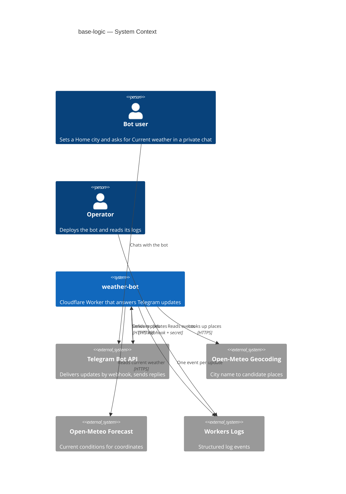
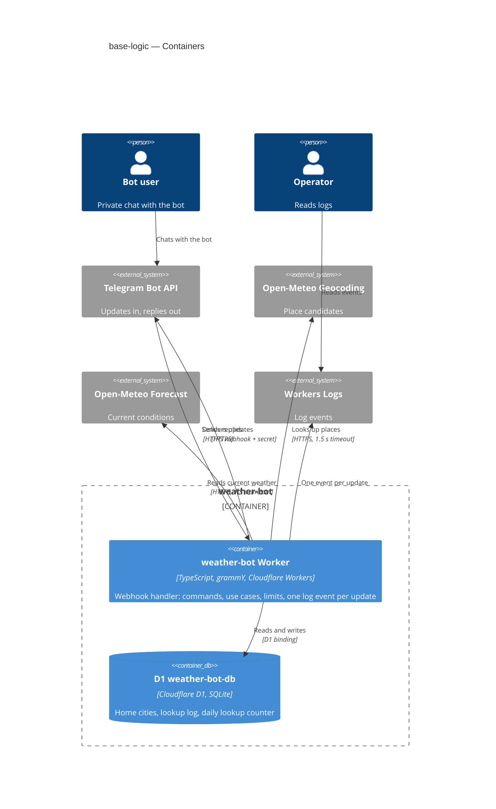
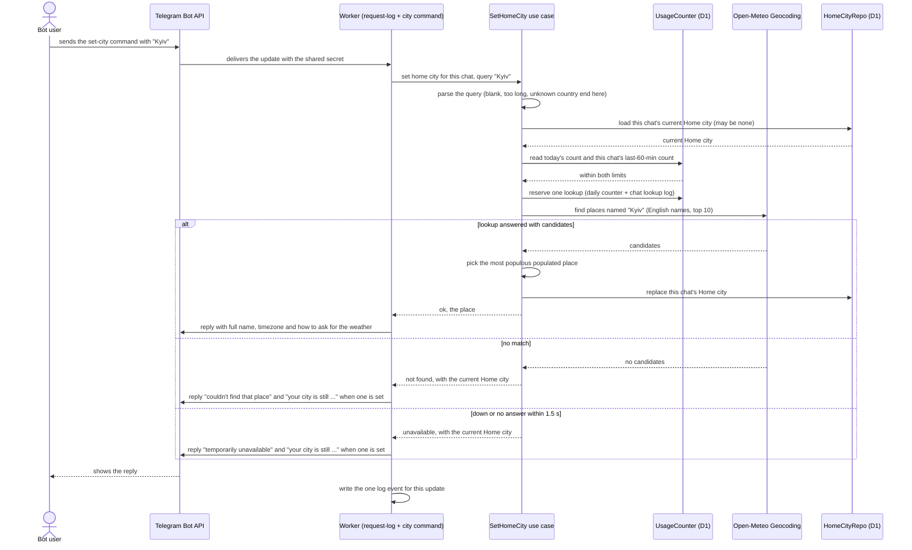
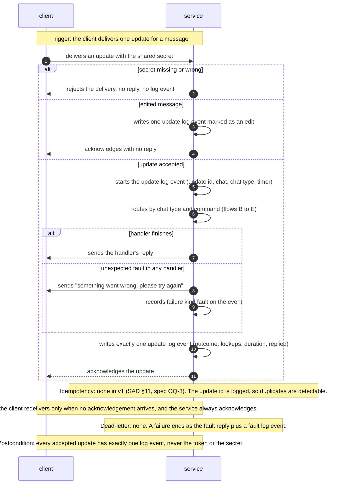
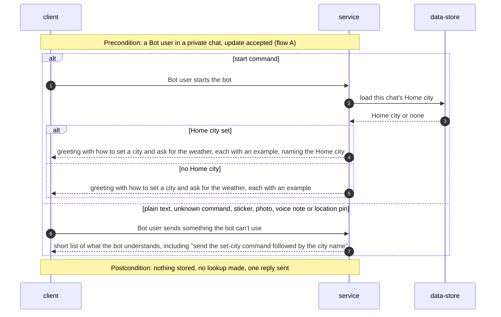
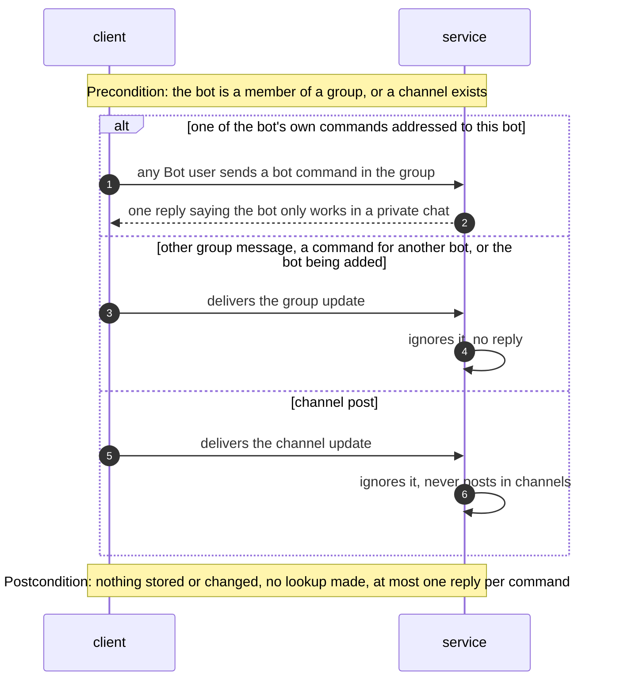
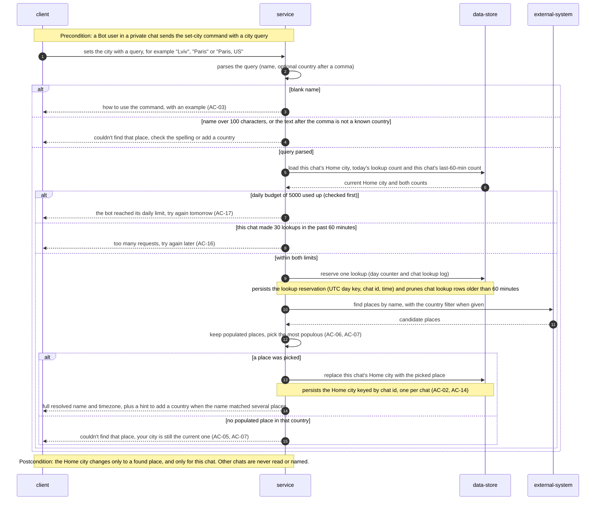
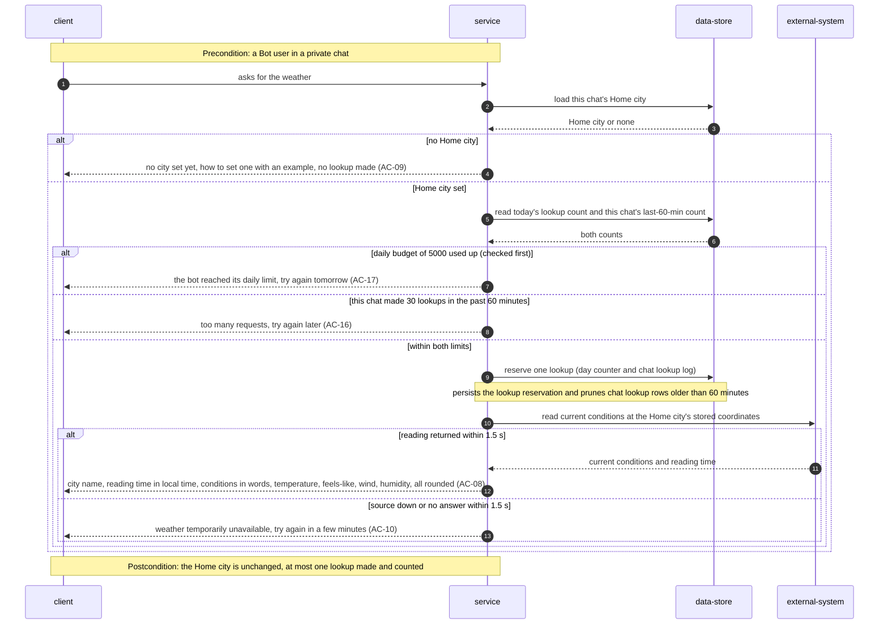

# Software Architecture Document — base-logic

> **Inputs:** [spec.md](./spec.md) · [CONTEXT](../../../CONTEXT.md) · [architecture-map](../../architecture-map.md) · project ADRs [0001](../../adr/0001-run-on-cloudflare-workers-with-webhook-and-cron.md), [0002](../../adr/0002-organize-code-as-ports-and-adapters.md), [0003](../../adr/0003-store-state-in-cloudflare-d1.md) · the scaffolded skeleton at `de5a77f`.

## 1. Introduction and goals

**Intent.** Turn the greeting-only skeleton into a usable bot. A Bot user sets their Home city with `/city <name>` and gets Current weather with `/weather`, in a private chat, in English and metric. The stored Home city (English name, coordinates, IANA timezone) is the foundation that step 3 (alerts) and step 4 (quiet hours) build on. Every message gets one plain-language reply. Usage is capped so one chat can't use up the weather source's shared free allowance.

**Top-3 quality goals (1-liners; full scenarios in §10):**

1. **Responsiveness:** every private-chat message gets exactly one reply, fast (QG-1).
2. **Budget protection:** the shared weather-source allowance can't be drained by one chat or by this step as a whole (QG-2).
3. **Fits the free plan per message:** CPU and outbound calls stay inside Workers Free limits (QG-3).

**Stakeholders.**

| Role | Interest | Sign-off owner? |
|---|---|---|
| Bot user | Sets a Home city, reads Current weather | No |
| Operator | Reads the per-update log event to see why a request failed; watches the budget | No |
| Tech Lead (Vlad S) | SAD approval | Yes |

<!-- Decision overrides (¶4) — populated by the critic resolution loop, empty otherwise. -->

- Decision override: `BOT_INFO` is required for production deploys, while it stays optional in code and in CLAUDE.md. Rationale: without it, every cold start makes an extra `getMe` subrequest and spends CPU, which threatens QG-3. It stays optional in `src/env.d.ts`, so local dev and tests run without it. Enforcement is the deploy checklist plus a startup warning log, not a hard failure (§7, §11).

## 2. Constraints

**Technical.**
- TypeScript `~6.0`, `strict`, on the Cloudflare Workers runtime (`compatibility_date = "2026-11-01"`); Node 26 LTS toolchain.
- grammY `^1.46` via `webhookCallback(bot, "cloudflare-mod", { secretToken })`; Wrangler `^4.157`; Vitest `^5.1` with `@cloudflare/vitest-plugin`.
- Cloudflare D1 (SQLite) as the only datastore, `DB` binding (project ADR-0003). Migrations are forward-only.
- Ports and adapters with ESLint-enforced layers (project ADR-0002): `domain` (pure) ← `app` (use cases + ports) ← `adapters`. The composition root is `src/worker.ts`.
- Weather source: the Open-Meteo forecast and geocoding APIs. No key, non-commercial use, about 10k calls a day for both together.
- Workers Free: 10 ms CPU per invocation, 50 subrequests per invocation. D1 Free: 5M rows read and 100k rows written a day.

**Organisational.**
- One owner and developer (Vlad S). No external deadline (`idea-brief.md` §4). Size S, route `quick`.

**Conventions.**
- [`CLAUDE.md`](../../../CLAUDE.md) and [`architecture-map.md` §Conventions](../../architecture-map.md):
  - Expected failures are returned as `Result<T, E>`, never thrown.
  - Time is read only through the `Clock` port and stored as UTC ISO-8601.
  - D1 is accessed only in `src/adapters/d1/`, with bound parameters.
  - Logging goes through `log(event, fields)`.
  - The webhook always answers 200.
- New bot command: `src/adapters/telegram/commands/<name>.ts`, registered in `bot.ts`, calling a use case in `src/app/`.

**Regulatory / external.**
- Open-Meteo terms: non-commercial use, CC-BY 4.0 attribution in the README.
- Personal data is a chat id plus approximate location (spec §6.1). There is no removal flow in v1; it is deferred to step 3 (spec OQ-2).

## 3. Context and scope

The bot is a single Cloudflare Worker that Telegram calls with every update. It resolves a typed city name into a place through Open-Meteo geocoding, stores it per chat in D1, and reads current conditions for that place from the Open-Meteo forecast API. Replies go back through the Telegram Bot API. The Operator sees one structured log event per update in Workers Logs.

<!-- brownfield: scaffolded skeleton (de5a77f) — worker.ts with /health + webhook, grammY bot with /start only, Clock port, log() helper, Result type, empty 0001 migration. architecture-map.md is still in greenfield mode (reflects 0262bf8) — refresh with /sdd:survey. -->

**External systems (in / out):**

| Actor or system | Type | Interaction |
|---|---|---|
| Bot user | Person | Sends `/start`, `/city <name>`, `/weather` and other messages in a private chat; may add the bot to a group |
| Operator | Person | Deploys the bot, reads the per-update log events |
| Telegram Bot API | System (external) | Delivers updates to the webhook with the shared secret header; receives `sendMessage` calls. **Trust boundary:** an update without the right secret is dropped silently. |
| Open-Meteo Geocoding API | System (external) | Turns a city query (plus an optional country filter) into candidate places with population, feature code, coordinates, timezone and English names |
| Open-Meteo Forecast API | System (external) | Returns current conditions for given coordinates |
| Workers Logs | System (external, Cloudflare) | Stores the one-line JSON log events |

**C4 Context (L1):**



## 4. Solution strategy

**Target surface:** `[backend-service]`, the existing weather-bot Worker answering Telegram webhooks. The Bot user's UI is the Telegram chat, which Telegram owns, so there is no web, mobile or desktop surface and no UI-architecture decision. A single surface means no ADR.

**Top strategic choices:**

1. **Resolve once at set-city, store the whole place.** `/city` makes the only geocoding calls and stores the chosen place's English name, region, country, coordinates and IANA timezone. `/weather` never geocodes; it reads the stored coordinates and timezone. A Latin-script name makes one lookup; a non-Latin name ("Київ") makes at most two: a search in its script's language, then an English re-fetch of the picked place ([ADR-0003](adr/0003-resolve-non-latin-names-with-a-localized-search.md)). Each request therefore stays within spec §6 "≤ 3 outbound calls", and alerts and quiet hours read the same stored place.
2. **Usage counters in D1** ([ADR-0001](adr/0001-count-lookups-in-d1-tables.md)). A per-chat lookup log gives the rolling 60-minute cap (AC-16). A per-UTC-day counter is reserved before each lookup, which enforces the 5,000/day budget (AC-17). The checks run in a fixed order before any outbound call (§8 "Request pipeline").
3. **One log event per update from a middleware collector** ([ADR-0002](adr/0002-emit-one-log-event-per-update-from-middleware.md)). The outermost grammY middleware owns timing and writes exactly one event in `finally`. Handlers only fill in fields.
4. **Stateless, private-only edge.** Every update is handled on its own, with no conversation state. Chat-type filtering happens at the bot edge: the private composer serves the commands, the group composer answers the bot's own commands with the "private chat only" pointer, and everything else is ignored. Use cases never see a non-private chat.

## 5. Building block view

The repo's ports-and-adapters layering (project ADR-0002) is unchanged. This feature adds pure rules to `domain`, two use cases plus ports to `app`, and the Open-Meteo, D1 and Telegram adapters. The composition root builds everything once per isolate: on the first update it builds the adapters, use cases and grammY `Bot` from `env`, which doesn't change within an isolate, and caches them at module scope. Command handlers close over those use cases. Only the update itself and the `Clock` reading are per request, so setup doesn't repeat on every update.

**Internal decomposition:**

```
src/
├── domain/
│   ├── place.ts            Place type; pickBestMatch(candidates) → populated places only, highest population, ties → source order
│   ├── city-query.ts       parseCityQuery(text) → Result<{ name, countryCode? }, blank | too_long | unknown_country>
│   ├── countries.ts        ISO 3166-1 alpha-2 ↔ English short name + aliases (USA, UK)
│   ├── usage-limits.ts     DAILY_LOOKUP_BUDGET = 5000, USER_LOOKUPS_PER_HOUR = 30; checkLimits(daily, user) → ok | daily_limit | user_limit
│   └── weather.ts          CurrentWeather type; WMO code → words ("unknown conditions" fallback); whole-number rounding
├── app/
│   ├── ports.ts            + PlaceLookup, WeatherProvider, HomeCityRepo, UsageCounter (Clock exists)
│   ├── set-home-city.ts    parse → load current → limits → reserve → lookup → pick → (non-Latin: limits → reserve → re-fetch in English) → save; Result<Place, SetCityError> (failures carry the current Home city, AC-05)
│   ├── get-current-weather.ts  home city? → limits → reserve → fetch; Result<{ place, weather }, WeatherError>
│   └── get-home-city.ts    for the /start greeting (no lookup)
├── adapters/
│   ├── open-meteo/geocoding.ts   PlaceLookup — find: top 10 candidates in the query's script language (en for Latin), optional country filter; findById: English names (ADR-0003); 1.5 s timeout
│   ├── open-meteo/forecast.ts    WeatherProvider — current fields at stored coordinates, metric, 1.5 s timeout
│   ├── d1/home-city-repo.ts      HomeCityRepo — one row per chat id, upsert replaces
│   ├── d1/usage-counter.ts       UsageCounter — per-chat lookup log (rolling 60 min, pruned) + per-UTC-day counter (ADR-0001)
│   └── telegram/
│       ├── bot.ts                composes: request-log → chat-type split → commands → fallback
│       ├── request-log.ts        middleware collector (ADR-0002)
│       ├── replies.ts            every user-facing text (plain text, no parse mode)
│       └── commands/{start,city,weather,help,group}.ts
└── worker.ts               composition root: adapters, use cases and Bot built once per isolate from env
migrations/NNNN_*.sql       home city + usage tables, staged by sdd:data-model
```

**C4 Container (L2):**



## 6. Runtime view

**Critical flow 1: set the Home city (AC-01, AC-04, AC-04b, AC-05, AC-16, AC-17)**



**Critical flow 2: ask for the weather (AC-08, AC-09, AC-10)**: the same shape. The use case first loads the Home city; if there is none, it replies "no city set" without touching the limits or making a lookup (AC-09). Otherwise it runs limits, then reserve, then one forecast call at the stored coordinates, and formats the reading in the Home city's timezone. `sdd:sequences` draws this and the remaining flows (group pointer, fallback, limits reached).

The flows below come from `sdd:sequences` (2026-11-05). They use the generic participants `client` (the Telegram side, delivering updates and receiving replies), `service` (the weather-bot Worker), `data-store` and `external-system` (the place or weather source). Every flow runs inside the cross-cutting intake (flow A), so each update writes exactly one log event and gets at most one reply.

### Cross-cutting: update intake and the one log event (AC-15, US-06)



### Start greeting and not-understood fallback (AC-11, AC-12, US-04)



### Group chat pointer (AC-13, US-05)



### Set the Home city: replace, refine, refusals and limits (AC-02, AC-03, AC-06, AC-07, AC-14, AC-16, AC-17, US-01, US-03)



### Ask for the weather (AC-08, AC-09, AC-10, AC-16, AC-17, US-02)



**Coverage (`sdd:sequences`, 2026-11-05).** Flow 1 is the existing set-city flow above. A to E are the flows drawn by `sdd:sequences`.

| User story | Flows |
|---|---|
| US-01 Set my Home city | 1, D |
| US-02 See the weather now | E |
| US-03 Correct a wrong match | D |
| US-04 Find my way in | B |
| US-05 Told where the bot works | C |
| US-06 Diagnose a failed request | A |

| AC | Shown in |
|---|---|
| AC-01 | flow 1 happy path |
| AC-02 | D, "a place was picked" branch (replace, one per chat) |
| AC-03 | D, "blank name" branch |
| AC-04 | flow 1 "no match" branch; D, "over 100 characters" branch |
| AC-04b | flow 1, "down or no answer within 1.5 s" branch |
| AC-05 | flow 1 failure branches; D, "no populated place in that country" branch |
| AC-06 | D, pick the most populous populated place, plus the ambiguity hint |
| AC-07 | D, country filter and "not a known country" / "no place in that country" branches |
| AC-08 | E, "reading returned within 1.5 s" branch |
| AC-09 | E, "no Home city" branch |
| AC-10 | E, "source down or no answer" branch |
| AC-11 | B, start command branches |
| AC-12 | B, fallback branch |
| AC-13 | C, all three branches |
| AC-14 | D, Home city keyed by chat id, postcondition |
| AC-15 | A, fault branch and the one log event |
| AC-16 | D and E, "30 lookups in the past 60 minutes" branch |
| AC-17 | D and E, "daily budget used up" branch (checked first) |

**Flags for later stages (no ADRs written):**
- Persist and read notes for `data-model`:
  - the Home city is read and replaced by chat id, one row per chat;
  - the lookup log is counted per chat over the last 60 minutes and pruned by time;
  - the day counter is read and incremented by UTC day key.
- Flow 1 (drawn by `design`) names concrete participants (Telegram Bot API, Open-Meteo Geocoding, D1 repos), while flows A to E use the generic vocabulary. It was left untouched because this stage is additive. Harmonising it is a deliberate manual edit, if wanted.
- Flow A records the async-webhook decision: no idempotency, no retry and no dead-letter in v1 (SAD §11, spec OQ-3). If duplicates show up in the log data, de-duplication becomes a `decide-adr` candidate.

## 7. Deployment view

No new deployment units. The feature ships inside the existing `weather-bot` Worker and its D1 database. It adds one or more forward migrations (staged by `sdd:data-model`) and no new bindings or secrets. `BOT_INFO` becomes required for production deploys (deploy checklist plus a startup warning; it stays optional in code, see §1 ¶4): without it, grammY calls `getMe` on every cold start, which uses an extra subrequest and CPU. The 15-minute cron (`scheduled`) is untouched.

**Monitoring:**
- Workers Logs: query `event = "update"` for outcome, failure kind, duration, lookups, chat. Every spec §6/§7 number comes from these events.
- Workers analytics: CPU time per invocation (p99 target ≤ 10 ms).
- Daily review by the Operator, with no paging: the sum of `lookups` per UTC day against 5,000, and the count of `daily_limit` outcomes.

**Scaling thresholds:**
- Lookups are capped at 5,000 a day, which means about 10k D1 writes a day (10% of D1 Free). The lookup log is pruned to the last 60 minutes, so it stays at most around 30 rows per active chat.
- Home city rows: one per chat. That's negligible at the expected handful of Bot users.
- If `daily_limit` outcomes appear on more than 3 days in a month, revisit the budget split with step 3 alerts, or add a per-location weather cache.

## 8. Crosscutting concepts

| Concept | Convention | Where defined |
|---|---|---|
| Logging | Exactly one `log("update", {...})` per update, written in `finally` by the request-log middleware. Fields: `update_id`, `is_edit` (bool), `chat`, `chat_type`, `command`, `outcome` (`ok` or a failure kind: `blank`, `too_long`, `not_found`, `unknown_country`, `unavailable`, `user_limit`, `daily_limit`, `no_home_city`, `not_understood`, `group_pointer`, `fault`), `lookups` (0, 1 or 2; ADR-0003), `duration_ms`, `reading_time` (weather only), `replied` (bool). Never the token, the secret or message text. | ADR-0002; here |
| Authentication | The webhook accepts only updates carrying `WEBHOOK_SECRET` (grammY `secretToken`). Anything else is dropped silently, with no reply and no log event. | architecture-map §Conventions |
| Authorization | Every Home city read or write is keyed by the chat id of the incoming update; no command accepts another chat's id. Use cases are reachable only from the private-chat composer. | spec §6.1; here |
| Composition | Adapters, use cases and the grammY `Bot` are built once per isolate from `env` and cached at module scope. Handlers close over the use cases, and nothing per-request is stored in module scope. | here |
| Error handling | Use cases return `Result`. `SetCityError` failures `too_long`, `unknown_country`, `not_found` and `unavailable` carry the current Home city (or none) so the reply can say "your city is still …" (AC-05). `SetCityError` is `blank`, `too_long`, `unknown_country`, `not_found`, `unavailable`, `user_limit` or `daily_limit`; `WeatherError` is `no_home_city`, `unavailable`, `user_limit` or `daily_limit`. `replies.ts` maps each to plain-language text. Unexpected throws become the "something went wrong" reply plus `outcome: fault`, and the webhook still answers 200. | CLAUDE.md; here |
| Request pipeline (order of checks) | 1. Parse the input (`blank`, `too_long`, `unknown_country`; the last two read the current Home city for the reply), or for `/weather` load the Home city (`no_home_city`). No lookup and no counting at this step. 2. Daily budget (`daily_limit` wins when both limits are hit). 3. Per-chat rolling 60 min (`user_limit`). 4. Reserve: increment the day counter and insert the chat log row. 5. One outbound lookup with a 1.5 s timeout. A non-Latin set-city whose search picked a place repeats 2–5 once for the English re-fetch (ADR-0003). | spec AC-16/AC-17; here |
| Outbound HTTP | `fetch` with `AbortSignal.timeout(1500)`. A timeout, network error or non-OK answer means `unavailable`. Open-Meteo adapters map JSON into domain types and never leak response shapes. | here |
| Text safety | Replies are plain text (no `parse_mode`). Echoed names come from the geocoder's resolved place, not from the raw query. | spec §6.1 |
| Time | `Clock` port only. Counters use UTC (day key `YYYY-MM-DD`, window `now − 60 min`). The reading time is shown in the Home city's IANA timezone via `Intl.DateTimeFormat`. | CLAUDE.md |
| ID strategy | Telegram chat id is the natural key for a Home city and the lookup log. The day counter is keyed by the UTC date. | architecture-map §Conventions |
| Internationalisation | N/A. English only, with English place names: a Latin query is searched with `language=en`; a non-Latin one in its script's language and then re-fetched with `language=en` (ADR-0003). | spec §3 |
| Units | Metric: °C and km/h from the source, humidity in %. Values rounded to whole numbers in `domain/weather.ts`. | spec AC-08 |
| Events | N/A. In-process calls through ports only. | architecture-map §Conventions |

## 9. Architecture decisions

| # | Title | Status | Section |
|---|---|---|---|
| 0001 | Count lookups in D1 tables (per-chat lookup log + per-day counter) | Accepted | §4 |
| 0002 | Emit one log event per update from a request-scoped middleware collector | Accepted | §4 |
| 0003 | Resolve non-Latin city names with a localized search and an English re-fetch (post-hoc, from T16) | Accepted | §4, §5, §8 |

ADR files live under `docs/features/base-logic/adr/NNNN-<title>.md`. Project-wide decisions (Workers + webhook, ports and adapters, D1) live in `docs/adr/` and are not repeated here.

## 10. Quality requirements

**QG-1. Responsiveness and reply rate**
- **When:** a Bot user sends any new private-chat message (set-city, weather, start, unknown text or non-text).
- **Then:** "≤ 2 s from receiving the message to sending the reply" (p95, set-city and weather), and "≥ 99% of new private-chat messages, of any kind (edits excluded), get exactly one reply". Each lookup gives up after 1.5 s, so a slow source still leaves time to reply.
- **How verify:** integration tests (workerd, stubbed fetch) assert exactly one reply per scenario, including a stubbed source that hangs past 1.5 s. In production: weekly p95 of `duration_ms`. The monthly reply rate is (distinct `update_id` on `update` events with `chat_type = private`, `is_edit = false` and `replied: true`) divided by (private, non-edit webhook invocations in the Workers invocation log, which still count requests killed before the event is written). The same `update_id` appearing more than once marks a redelivery that got two replies.

**QG-2. Budget protection**
- **When:** one chat sends lookups in a burst, or the whole bot approaches its daily allowance.
- **Then:** "≤ 30 lookups per Bot user in any rolling 60 minutes (AC-16)" and "≤ 5,000 a day in total, enforced (AC-17; half the free cap, leaving the rest for step 3 alerts)". Blocked requests make no lookup and get the matching reply.
- **How verify:** integration tests at the boundary (the 30th lookup allowed, the 31st blocked; a day counter at 5,000 blocks; blocked retries don't extend the window; the daily reply wins when both limits apply). In production: daily sum of `lookups`.

**QG-3. Fits the free plan per message**
- **When:** any update is processed.
- **Then:** "CPU per message ≤ 10 ms p99" and "Outbound calls per message ≤ 3 (one lookup, one reply, one spare; the platform cap is 50)".
- **How verify:** integration tests count the stubbed outbound calls per scenario (at most 1 lookup + 1 reply; a non-Latin set-city at most 2 lookups + 1 reply, ADR-0003). Workers analytics CPU time p99 after launch. `BOT_INFO` is set, so there is no `getMe` call on cold start.

Freshness ("≤ 30 min old, p95") is a monitored target only (spec §6): `reading_time` is on the event and is not enforced in code.

## 11. Risks and technical debt

| Risk / debt | Severity | Mitigation | Owner |
|---|---|---|---|
| Wrong city stored for an ambiguous name (Open-Meteo ranking, missing population) | Medium | The reply shows the full resolved name and timezone; the Bot user refines with ", <country>". The §7 wrong-match KPI (> 15%) triggers revisiting the "no picking with buttons" non-goal. | Vlad S |
| CPU over 10 ms when an isolate starts cold (grammY setup, JSON parsing) kills the request with no reply | Medium | Cache the Bot per isolate, require `BOT_INFO` in production, keep domain work linear and small. Watch CPU p99 in Workers analytics after launch. | Vlad S |
| `BOT_INFO` missing in production → extra `getMe` subrequest and CPU on every cold start | Low | Deploy checklist in the README; startup log warns when it's absent. It stays optional in code (§1 ¶4 override). | Vlad S |
| Telegram redelivers an update after a timeout → two replies, or an old set-city applied late (spec OQ-3) | Low | Accepted for v1: no de-duplication; the last set-city processed wins and is visible in the reply. Revisit if the reply-rate event data shows duplicates. | Vlad S |
| D1 daily quota exhausted → queries fail → "something went wrong" replies | Low | About 10k writes a day at the full lookup budget (10% of the free tier); `fault` outcomes are visible in the logs | Vlad S |
| Country table drift (a new code or name not recognised) | Low | Static ISO 3166-1 alpha-2 table in `domain/countries.ts` with unit tests; an unknown country falls to "couldn't find" (AC-07) | Vlad S |

**Accepted debt (acceptable in v1, plan to fix later):**
- No "forget me" / Home city removal: deferred to step 3 (spec OQ-2).
- No cache of weather readings: at a handful of users and a 5,000/day cap, every `/weather` costs one lookup. Add a per-location cache only if the monitoring threshold in §7 fires.
- Two requests racing in the same instant can push the counters past their limits by one or two (ADR-0001); the spec accepts this.

## 12. Glossary

| Term | Meaning |
|---|---|
| Bot user | A person who talks to the bot on Telegram; only in their private chat can they have a Home city (CONTEXT.md) |
| Operator | The owner who deploys the bot and reads its logs; no in-bot powers in v1 (CONTEXT.md) |
| Home city | The one place a Bot user has chosen, stored with its full English name, coordinates and timezone; setting again replaces it (CONTEXT.md) |
| Current weather | Conditions at the Home city at the moment of asking, as reported by the weather source (CONTEXT.md) |
| City query | The raw text after the set-city command, with an optional ", <country>" suffix. Not the stored Home city. |
| Lookup | One outbound call to Open-Meteo, geocoding or forecast. The unit both limits count. |
| Daily lookup budget | 5,000 lookups per UTC day for Bot user requests (AC-17); the rest of the source's allowance is left for alerts |
| Per-user limit | 30 lookups per chat in any rolling 60 minutes (AC-16) |
| Populated place | A geocoding result whose feature code marks a city, town or village, as opposed to a region or country |
| Update log event | The single `update` log line written per Telegram update (ADR-0002) |
