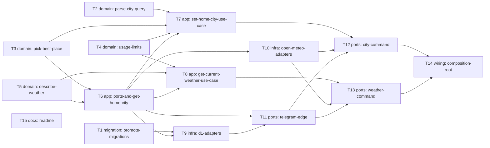

# Epic — base-logic

> **Spec:** [spec.md](../spec.md) · **Design:** [sad.md](../sad.md) · **Data model:** [data-model.md](../data-model.md) · **API:** none (`api` skipped on the quick route: no contract change) · **ADRs:** [adr/](../adr/)

## Goal

A first-time Bot user sets a Home city with `/city <name>` and reads Current weather with `/weather`, in a couple of messages and without reading docs (spec §2). Every stored Home city is unambiguous (English name, coordinates, IANA timezone), so roadmap steps 3 and 4 can build on it. Every request ends in a plain-language reply and exactly one log event, inside the per-chat and bot-wide lookup budgets.

## Scope

- **In:** the three D1 tables (staged migrations), domain rules (`city-query`, `countries`, `place`, `usage-limits`, `weather`), the use cases (`set-home-city`, `get-current-weather`, `get-home-city`) with their ports, the D1 and Open-Meteo adapters, the Telegram edge (request-log middleware, private/group split, `/start`, `/city`, `/weather`, help), the per-isolate composition root, and the README.
- **Out (spec §3):** more than one city per Bot user, location pins, picking among matches with buttons, group or channel use beyond the pointer, "forget me" removal (OQ-2, step 3), forecasts, digests, unit switching and other languages.

## Task map

- **Wave 1:** T1, T2, T3, T4, T5, T15
- **Wave 2:** T6
- **Wave 3:** T7, T8, T9, T10
- **Wave 4:** T11
- **Wave 5:** T12, T13
- **Wave 6:** T14

Parallel branches: wave 1 runs six independent tasks (migration, four domain tasks, docs), and wave 3 runs the two use cases next to the D1 and Open-Meteo adapters. T11 → T12/T13 → T14 share `bot.ts` / `replies.ts` / `worker.ts`, so `implement` serializes that lane.

## Tasks

See [tracker.md](./tracker.md) for status. Machine contract: [tasks.json](../tasks.json).

| # | Task | Layer | Blocked by | Wave | Context |
|---|---|---|---|---|---|
| T1 | [Promote the three staged base-logic migrations](./t01-promote-migrations.md) | migration | — | 1 | M |
| T2 | [Parse the city query and recognise countries](./t02-parse-city-query.md) | domain | — | 1 | M |
| T3 | [Pick the best-matching populated place and format its name](./t03-pick-best-place.md) | domain | — | 1 | M |
| T4 | [Encode the lookup limits and UTC counting keys](./t04-usage-limits.md) | domain | — | 1 | S |
| T5 | [Describe and round the current weather reading](./t05-describe-weather.md) | domain | — | 1 | S |
| T6 | [Declare the four new ports and the get-home-city use case](./t06-ports-and-get-home-city.md) | app | T3, T5 | 2 | S |
| T7 | [Implement the set-home-city use case](./t07-set-home-city-use-case.md) | app | T2, T3, T4, T6 | 3 | M |
| T8 | [Implement the get-current-weather use case](./t08-get-current-weather-use-case.md) | app | T4, T5, T6 | 3 | M |
| T9 | [Implement the D1 HomeCityRepo and UsageCounter adapters](./t09-d1-adapters.md) | infra | T1, T6 | 3 | M |
| T10 | [Implement the Open-Meteo geocoding and forecast adapters](./t10-open-meteo-adapters.md) | infra | T6 | 3 | M |
| T11 | [Build the Telegram edge: request-log middleware, chat-type split, start, help and group replies](./t11-telegram-edge.md) | ports | T6, T9 | 4 | M |
| T12 | [Add the /city command and its replies](./t12-city-command.md) | ports | T7, T10, T11 | 5 | M |
| T13 | [Add the /weather command and its replies](./t13-weather-command.md) | ports | T8, T10, T11 | 5 | M |
| T14 | [Build the bot once per isolate and verify the per-message budgets end to end](./t14-composition-root.md) | wiring | T12, T13 | 6 | M |
| T15 | [Update the README for the new commands and the BOT_INFO deploy step](./t15-readme.md) | docs | — | 1 | S |

## Risks / Hard rules

- Layers (ADR-0002, ESLint): `domain` is pure; `app` imports only `domain`; D1 only in `src/adapters/d1/` with bound parameters.
- `Result<T, E>` for expected failures; time only through `Clock`; UTC ISO-8601 storage.
- One `update` log event per update (feature ADR-0002); never the token, the secret or message text.
- Check order: parse → daily budget → per-chat window → reserve → one lookup with a 1.5 s timeout (SAD §8). Every reserved lookup counts, including failures (AC-17).
- Free plan: ≤ 10 ms CPU p99 and ≤ 3 outbound calls per message (spec §6). The webhook always answers 200.
- Migrations are forward-only (project ADR-0003). T1 promotes the staged files and never edits an applied one.
- Watch item: D1 writes are about 5 rows per lookup, roughly 25% of D1 Free at the full budget ([audit](../_audit/data-model-2026-11-06.md)).
