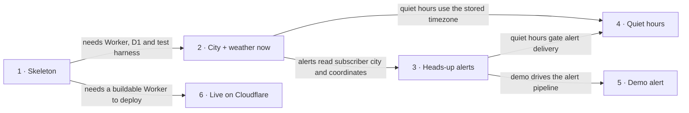

# Roadmap — weather-bot

> **A decomposition, not a promise.** The overall idea broken into incremental steps: what each
> step is, where it comes from, how big it is — or that nobody has looked at it yet — and in which
> order, and parallel lanes, we walk them. **No dates** (except shipped history), **no scores** —
> order is the prioritization. The *solution* for any step lives in its `docs/features/<slug>/`
> spec, not here.

## Destination

Anyone can open the live bot in Telegram, get the current weather for their city, receive heads-up alerts about notable weather that respect their quiet hours, and trigger a demo alert on demand.

## Steps

| # | Step | Source | Size | Status |
|---|---|---|:---:|---|
| 1 | Project skeleton: the folder layout, the Worker entry point with `/start`, the test setup, D1 migrations, lint and CI | `architecture-map.md` §Module inventory · `features/_scaffold/tasks.json` | S | idea |
| 2 | Pick a city and get the weather now: set a city (geocoded, timezone stored) and ask for its current weather | `idea-brief.md` §7. Recommendation · [`features/base-logic/spec.md`](features/base-logic/spec.md) | S | shipped |
| 3 | Heads-up alerts: a check every 15 min warns about rain soon or a sharp temperature change, without repeating itself | `idea-brief.md` §7. Recommendation | M | idea |
| 4 | Quiet hours: set a window in your own timezone, and alerts due inside it are held until it ends | `idea-brief.md` §7. Recommendation | S | idea |
| 5 | Demo alert: `/demo_alert` runs a real alert through the actual pipeline on sample data, plus a README GIF | `idea-brief.md` §7. Recommendation | XS | idea |
| 6 | Bot is live on Cloudflare: deployed Worker, production secrets, Telegram webhook registered, deploy steps documented | `idea-brief.md` §2. Problem · `adr/0001-run-on-cloudflare-workers-with-webhook-and-cron.md` §Decision outcome | XS | idea |

## Not yet specified

None. Every step can be stated precisely now; the remaining unknowns are open decisions below.

| Area | What we'd have to learn | Blocks | How it gets sharpened |
|---|---|:---:|---|
| — | — | — | — |

## Out of scope

- Daily digest or scheduled summaries: v1 is alerts only (`idea-brief.md` §5).
- Following multiple cities per user: widens the data model (`idea-brief.md` §5).
- Choosing a location with a Telegram location pin: a city name is enough for v1 (`idea-brief.md` §5).
- "What to wear" or umbrella tips: little value for the effort (`idea-brief.md` §5).
- Languages other than English: no i18n in v1 (`idea-brief.md` §5).
- A web UI or dashboard: Telegram is the only interface (`idea-brief.md` §5).
- Any paid hosting tier: free only is owner-required (`idea-brief.md` §5).

## Open decisions

| # | Question | Type | Owner | Blocks |
|---|---|:---:|:---:|:---:|
| D1 | Does one scheduled alert check, a batched Open-Meteo fetch plus rule evaluation for all subscribers, fit the Workers Free limit of 10 ms CPU per Cron Trigger and 50 subrequests? If not, how many subscribers per tick? | prototype | agent | 3 |
| D2 | What exact thresholds count as notable: how far ahead "rain soon" looks, the minimum probability or amount, and how big a temperature jump over what window? | grilling | human | 3 |

## Decisions so far

- Run on Cloudflare Workers Free with a Telegram webhook and a 15-min cron trigger → [`adr/0001`](adr/0001-run-on-cloudflare-workers-with-webhook-and-cron.md)
- Ports-and-adapters layout with a pure domain layer → [`adr/0002`](adr/0002-organize-code-as-ports-and-adapters.md)
- Store state in Cloudflare D1, with forward-only Wrangler migrations → [`adr/0003`](adr/0003-store-state-in-cloudflare-d1.md)
- v1 scope (city weather, alerts, quiet hours, demo alert) and exclusions → [`idea-brief.md` §7](idea-brief.md)
- Workers Free limits confirmed: 10 ms CPU per request and per Cron Trigger, 50 subrequests, 5 cron triggers, 100k requests a day → [Cloudflare Workers limits](https://developers.cloudflare.com/workers/platform/limits/)
- Open-Meteo free API is non-commercial only, with fewer than 10k calls a day, 5k an hour and 600 a minute, and CC-BY 4.0 data → [Open-Meteo terms](https://open-meteo.com/en/terms)

## Dependency graph

## Execution path

| Wave | Steps | Zone per step (why parallel-safe) | Unlocks |
|:---:|---|---|---|
| 1 | 1 | repo root, `src/`, `test/`, `migrations/`, `.github/workflows/ci.yml` (new) | 2, 6 |
| 2 | 2 ∥ 6 | 2: `src/domain/`, `src/app/`, `src/adapters/` (new) · 6: `.github/workflows/deploy.yml` (new), README deploy section (new). Code vs. deploy config, so disjoint. | 3 |
| 3 | 3 | `src/domain/alerts/`, `src/app/run-alert-check` (new), `migrations/` (new) | 4, 5 |
| 4 | 4 ∥ 5 | 4: `src/domain/quiet-hours/`, `src/app/run-alert-check` (new) · 5: `src/adapters/telegram/commands/demo-alert.ts`, `test/fixtures/` (new). Both add a one-line command registration in `src/adapters/telegram/bot.ts` (new), a trivial merge. | — |

## Shipped

| Step | Shipped | Link |
|---|---|---|
| 2 · Pick a city and get the weather now | 2026-11-07 | [changelog](features/base-logic/_ship/changelog.md) · [PR #1](https://github.com/SanahurskyiV/weather-app/pull/1) |
